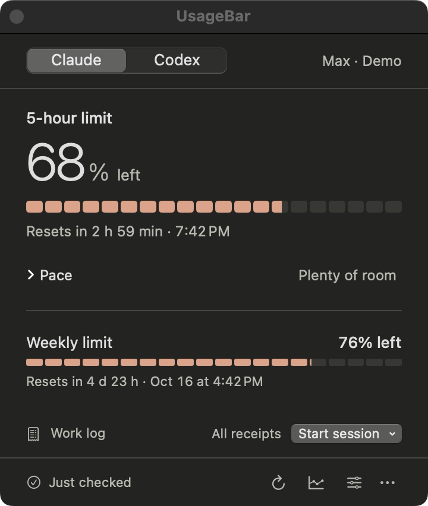

# UsageBar

A macOS menu bar app that shows how much of your Claude Code and Codex subscription limits remain. Start a work session and finish it to get a receipt of how much the limits moved.

[한국어](README.md)

<p align="center">
  
</p>

- **At a glance**: the 5-hour limit as a big number and gauge, with its reset time. The weekly limit follows below.
- **Work receipts**: pick a session type under **Start session** and a receipt records the duration and limit change when you finish.
- **History**: chart remaining limits over time and Codex daily tokens, and export CSV.
- **No new logins**: uses the Claude Code and Codex CLI logins already on this Mac. No passwords or API keys are entered.

<p align="center">
  
  
  
</p>

<sub>Codex panel · Receipts · History. All screenshots use demo data.</sub>

## Install

macOS 14 or later, Apple Silicon.

1. Download `UsageBar-<version>-<build>.zip` from [Releases](https://github.com/hyjoong/UsageBar/releases). The automatic **Source code** archives are not the app.
2. Unzip, move `UsageBar.app` to **Applications**, and open it.
3. Click the **U** icon in the menu bar. There is no main window or Dock icon.

Updates install from Settings → About → **Check for Updates…**. Settings and history are kept.

## Connecting

On first launch the panel walks through the connection in numbered steps. If you only use one service, the **I only use …** link turns the other one off.

<p align="center">
  
</p>

- **Claude**: install the Claude Code CLI, press **Open setup** to finish setup and log in from Terminal, then press **Check again**.
- **Codex**: install the Codex CLI, run `codex login` with your ChatGPT subscription account, then press **Check again**. API key billing is not supported.

## Usage

| Task | How |
| --- | --- |
| See remaining limits | Click the U icon. The big number is the 5-hour limit; other limits such as weekly follow below. |
| Record a session | Choose a type under **Start session**. Finishing records the duration and limit change in percentage points; **All receipts** lets you copy or delete them. |
| Review or export history | Click the history icon at the bottom, choose service, period, and limit, then **Export CSV**. |
| Keep the panel visible | ⋯ menu → **Open as Window**. The window floats above others. Launching the app again opens the same window. |
| Show both services | Settings → Menu Bar → **Show services** → **All enabled services**. |
| Launch at login, alerts | Settings → **Launch UsageBar at login**, **Notify when a limit drops below 20%**. |

Receipt numbers are the **account-wide** change over the observed interval. They include other windows and devices and are not a project's token count or cost. When a reset or an account or plan change makes a comparison impossible, the receipt says why.

## Troubleshooting

| Symptom | What to check |
| --- | --- |
| The icon is missing | When the menu bar is full, macOS hides items under the notch. Remove some Control Center items or use a menu bar manager. Meanwhile, launching UsageBar again opens the panel as a window. |
| It says a login is needed | Log in with the CLI in Terminal, then press **Check again**. |
| It shows an earlier record or an error | That is the last successful check. Verify your internet connection and CLI login, then refresh. The ⋯ menu links to the service status page. |
| Refresh is locked | The service is rate limiting requests. Wait for the time shown. |

## Privacy

- Uses each CLI's existing login; never asks for or stores passwords, API keys, or tokens.
- Usage history and receipts live only in `~/Library/Application Support/UsageBar/`. Conversations, project files, and raw CLI responses are not stored.
- Billing dates, amounts, and per-project costs are not shown, and nothing consumes reset credits.

Details (in Korean) are in [docs/PRIVACY.md](docs/PRIVACY.md).

## Development

```sh
swift build && swift test
swift run UsageBar --demo
```

The source build, demo screens, release process, design notes, and changelog are documented in Korean under [docs/](docs/) and [CHANGELOG.md](CHANGELOG.md). The UI string catalog is `Resources/Localizable.xcstrings` (Korean source, English translations).
