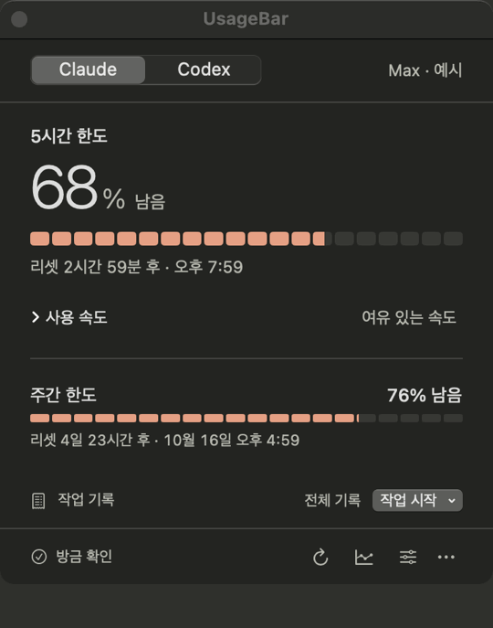
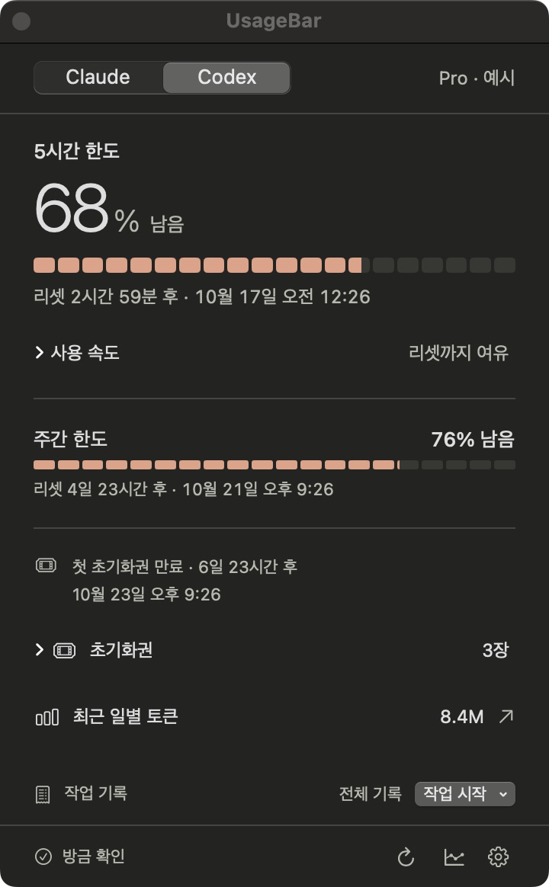
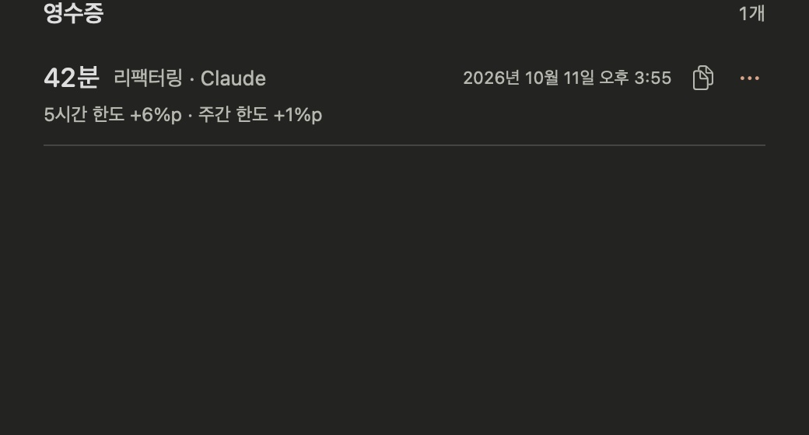
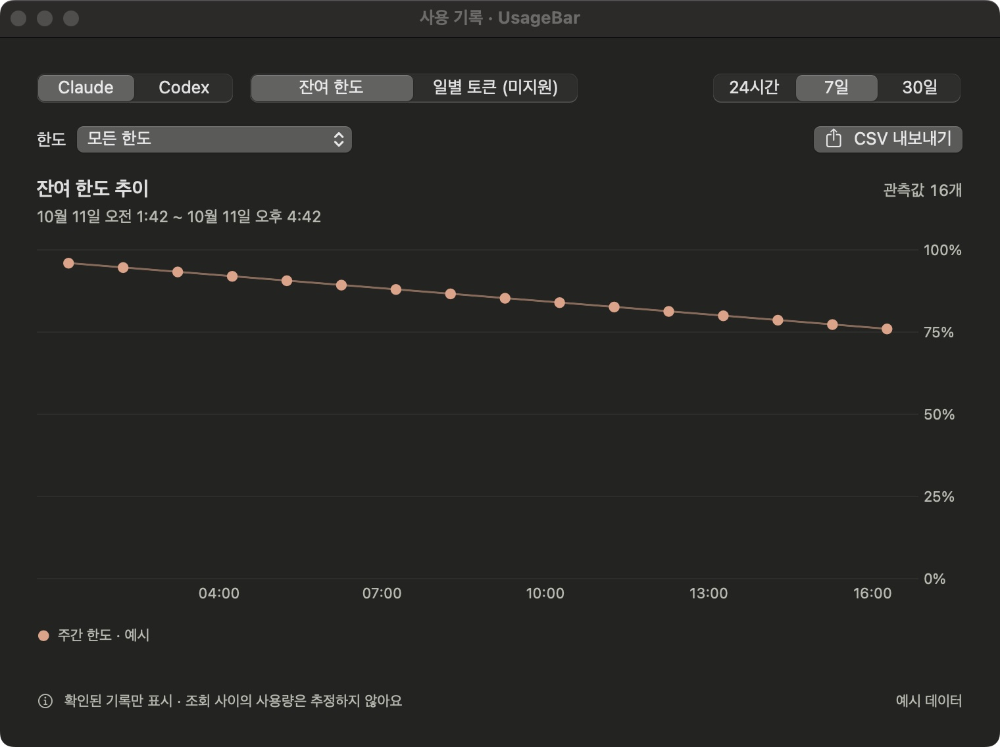
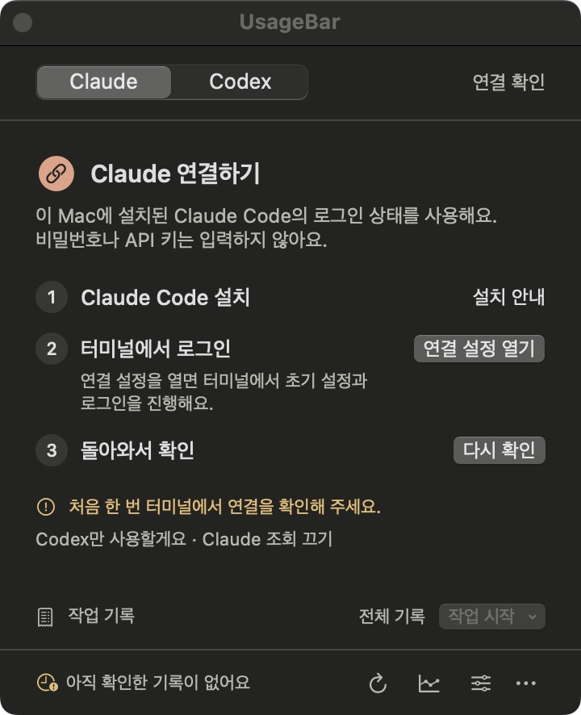

<p align="center">
  
</p>

<h1 align="center">UsageBar</h1>

<p align="center">
  Claude Code와 Codex의 구독 한도를 메뉴 막대에서.<br />
  작업 하나가 한도를 얼마나 썼는지 영수증으로 남깁니다.
</p>

<p align="center">
  <a href="https://github.com/hyjoong/UsageBar/releases"></a>
  
  
  
  <a href="LICENSE"></a>
</p>

<p align="center">
  <a href="#설치">설치</a> ·
  <a href="#기능">기능</a> ·
  <a href="#사용법">사용법</a> ·
  <a href="#자주-묻는-질문">FAQ</a> ·
  <a href="#개인정보">개인정보</a> ·
  <a href="#라이선스">라이선스</a> ·
  <a href="README.md">English</a>
</p>

<p align="center">
  
</p>

## 기능

- **한눈에.** 5시간 한도를 큰 숫자와 20칸 게이지로, 정확한 리셋 시각과 함께 봅니다. 주간 한도는 아래에 이어지고, 메뉴 막대에는 잔여율이 항상 떠 있습니다.
- **작업 영수증.** 작업 유형을 고르고 일한 뒤 종료를 누르면, 소요 시간과 한도별 변화(%p)가 영수증으로 남습니다.
- **사용 기록.** 잔여 한도 추이와 Codex 일별 토큰을 차트로 보고 CSV로 내보냅니다.
- **두 서비스.** Claude Code와 Codex를 나란히, 또는 쓰는 것만.
- **새로 로그인할 것 없음.** 이 Mac에 있는 CLI 로그인 상태를 그대로 읽습니다. 비밀번호나 API 키를 묻지 않습니다.
- **방해하지 않음.** 내용에 맞게 크기가 잡히는 팝오버, 계속 보고 싶을 때는 떠 있는 창, 켜면 20% 이하 알림.
- **한국어와 영어.** 시스템 언어를 따릅니다.

<p align="center">
  
  
  
</p>

<p align="center"><sub>Codex 패널 · 작업 영수증 · 사용 기록. 모든 스크린샷은 예시 데이터입니다.</sub></p>

## 설치

**필요한 것:** macOS 14 이상의 Apple Silicon Mac, 그리고 구독 계정으로 로그인한 [Claude Code](https://code.claude.com/docs/en/quickstart) 또는 [Codex](https://github.com/openai/codex) CLI.

**Homebrew**

```sh
brew install --cask hyjoong/tap/usagebar
```

**직접 설치**

1. [최신 릴리스](https://github.com/hyjoong/UsageBar/releases/latest)에서 `UsageBar-버전-빌드.zip`을 받습니다. GitHub가 자동으로 붙이는 *Source code*는 앱이 아닙니다.
2. 압축을 풀고 `UsageBar.app`을 **응용 프로그램** 폴더로 옮깁니다.

그다음 열고 메뉴 막대의 **U** 아이콘을 누릅니다. 별도 창이나 Dock 아이콘은 뜨지 않습니다.

앱은 Developer ID로 서명되고 Apple 공증을 거쳤습니다. 새 버전은 설정 → 앱 정보 → **업데이트 확인…**으로 그 자리에서 설치되며, 설정과 기록은 유지됩니다.

## 계정 연결

처음 실행하면 패널이 연결 과정을 세 단계로 안내합니다. 한 서비스만 쓴다면 **…만 사용할게요** 링크로 다른 서비스를 끌 수 있습니다.

<p align="center">
  
</p>

| 서비스 | 할 일 |
| --- | --- |
| **Claude** | Claude Code CLI를 설치한 뒤 **연결 설정 열기**를 눌러 터미널에서 초기 설정과 로그인을 마치고 **다시 확인**을 누릅니다. |
| **Codex** | Codex CLI를 설치하고 터미널에서 `codex login`으로 ChatGPT 구독 계정에 로그인한 뒤 **다시 확인**을 누릅니다. API 키 계정의 요금은 지원하지 않습니다. |

## 사용법

| 하고 싶은 일 | 조작 |
| --- | --- |
| 남은 한도 확인 | U 아이콘을 누릅니다. 큰 숫자는 5시간 한도이고 다른 한도는 아래에 이어집니다. |
| 작업 영수증 남기기 | **작업 시작**에서 유형을 고릅니다. 끝내면 소요 시간과 한도 변화(%p)가 남고, **전체 기록**에서 복사·삭제합니다. |
| 사용량 변화 확인·내보내기 | 하단 기록 아이콘 → 서비스·기간·한도를 고르고 **CSV 내보내기**. |
| 패널을 계속 보기 | ⋯ 메뉴 → **창으로 열기**. 다른 창 위에 떠 있습니다. 앱을 다시 실행해도 같은 창이 열립니다. |
| 메뉴 막대에 두 서비스 표시 | 설정 → 메뉴 막대 → **표시할 서비스** → **사용 중인 서비스 모두**. |
| 로그인 시 실행·알림 | 설정 → **로그인 시 UsageBar 실행**, **남은 한도가 20% 아래로 내려가면 알림**. |

**영수증 읽는 법.** 숫자는 관측 구간의 *계정 전체* 사용률 변화입니다. 다른 창이나 기기의 사용도 포함되며 특정 프로젝트의 토큰 수나 비용이 아닙니다. 리셋을 지나거나 계정·플랜이 바뀌어 비교가 무의미하면 숫자 대신 사유를 표시합니다.

## 자주 묻는 질문

**메뉴 막대에 아이콘이 없어요.**
메뉴 막대가 꽉 차면 macOS가 노치 아래 아이템을 숨기는데, 새로 추가된 앱이 바로 그 옆에 놓입니다. 제어 센터 항목을 몇 개 줄이거나 메뉴 막대 정리 앱을 쓰고, 그 뒤 ⌘를 누른 채 U 아이콘을 오른쪽으로 끌어 자리를 잡아 두세요. 그 사이에는 UsageBar를 다시 실행하면 패널 창이 열립니다.

**로그인이 필요하다고 나와요.**
터미널에서 해당 CLI 로그인을 마친 뒤 **다시 확인**을 누릅니다. UsageBar는 로그인을 대신 처리하지 않습니다.

**"이전 기록"이나 오류가 보여요.**
마지막으로 성공한 값입니다. 인터넷과 CLI 로그인 상태를 확인한 뒤 새로고침하세요. ⋯ 메뉴에 서비스 장애 현황 링크가 있습니다.

**새로고침이 비활성화돼 있어요.**
서비스가 요청을 제한한 상태입니다. 다시 확인할 수 있는 시각을 표시합니다.

**Intel Mac에서도 되나요?**
배포본은 Apple Silicon용입니다. Intel 빌드는 검증하지 않았습니다.

## 개인정보

- 각 CLI의 기존 로그인을 사용하며 비밀번호·API 키·토큰을 묻거나 저장하거나 전송하지 않습니다.
- 사용량 기록과 영수증은 `~/Library/Application Support/UsageBar/`에만 저장됩니다. 대화 내용, 프로젝트 파일, CLI 원문 응답은 저장하지 않습니다.
- 구독 종료일·결제액·프로젝트별 비용은 표시하지 않으며 초기화권을 소비하는 기능도 없습니다.
- 분석·텔레메트리가 없습니다. 네트워크 활동은 CLI의 사용량 조회와, 끌 수 있는 서명된 업데이트 확인뿐입니다.

상세는 [docs/PRIVACY.md](docs/PRIVACY.md)에 있습니다.

## 개발

```sh
git clone https://github.com/hyjoong/UsageBar.git
cd UsageBar
swift build && swift test
swift run UsageBar --demo      # 예시 데이터, 계정 접근 없음
zsh scripts/build-app.sh       # 서명된 .app을 build/에 생성
```

Swift Package Manager 위에 SwiftUI·AppKit·Swift Charts를 쓰고, 앱 내 업데이트는 [Sparkle](https://sparkle-project.org)입니다. UI 문자열은 `Resources/Localizable.xcstrings`(원문 한국어, 영어 번역)에 있습니다. 소스 빌드, 화면 확인 옵션, 배포 절차, 디자인 메모, 변경 이력은 [docs/](docs/)와 [CHANGELOG.md](CHANGELOG.md)에 있습니다.

버그 리포트와 풀 리퀘스트를 환영합니다. 설치된 CLI의 출력이나 프로토콜이 바뀌면 `Sources/UsageBarCore`의 프로바이더 코드를 보면 됩니다.

## 라이선스

[MIT](LICENSE) © 2026 Hyunjoong Kim. 앱 내 업데이트에 쓰는 [Sparkle](https://sparkle-project.org)의 라이선스는 앱 번들 안에 함께 들어 있습니다.
