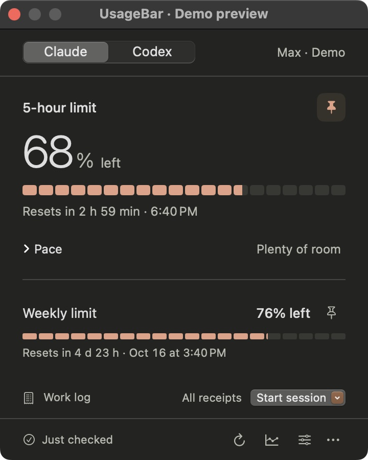
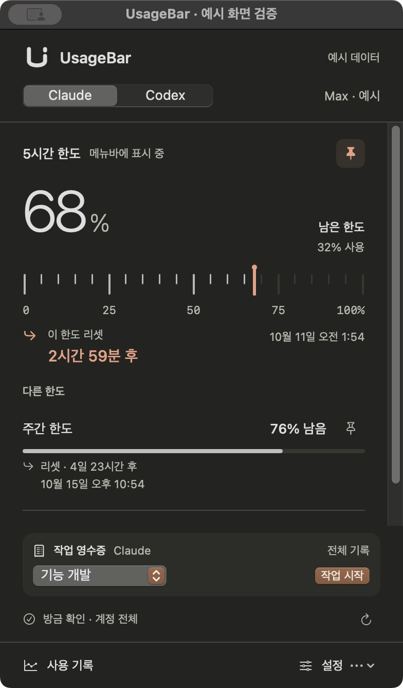
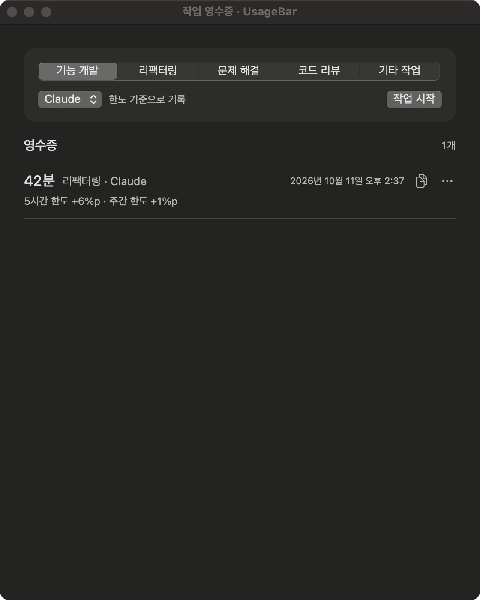
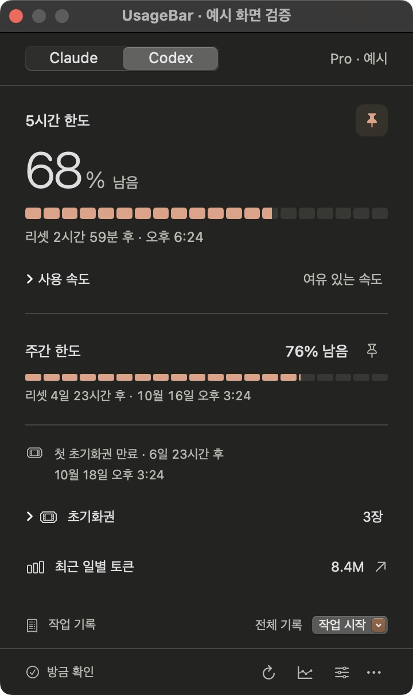
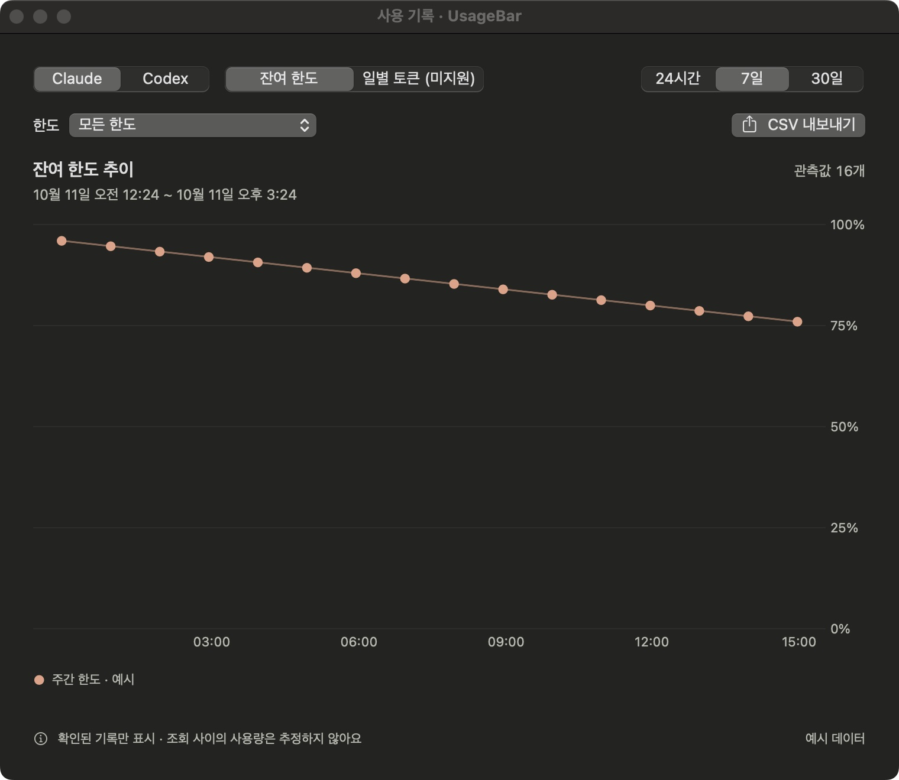
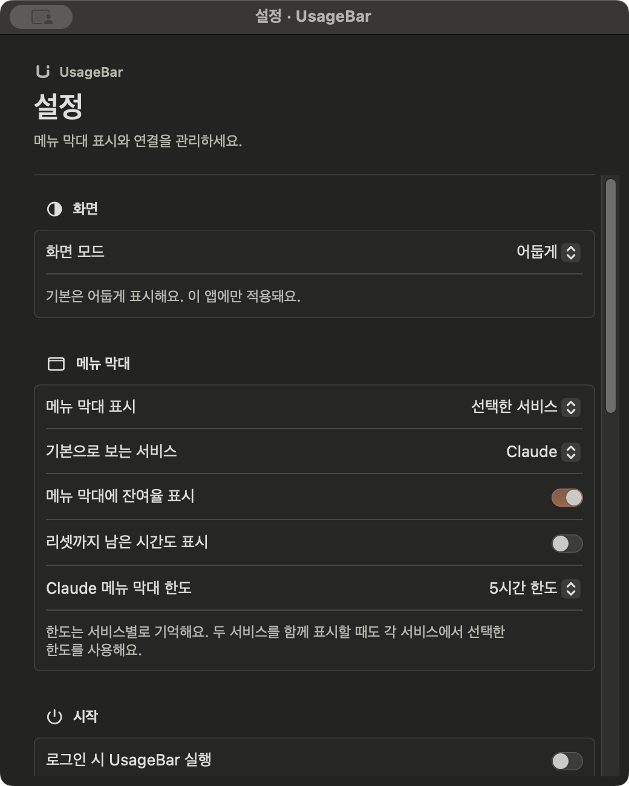
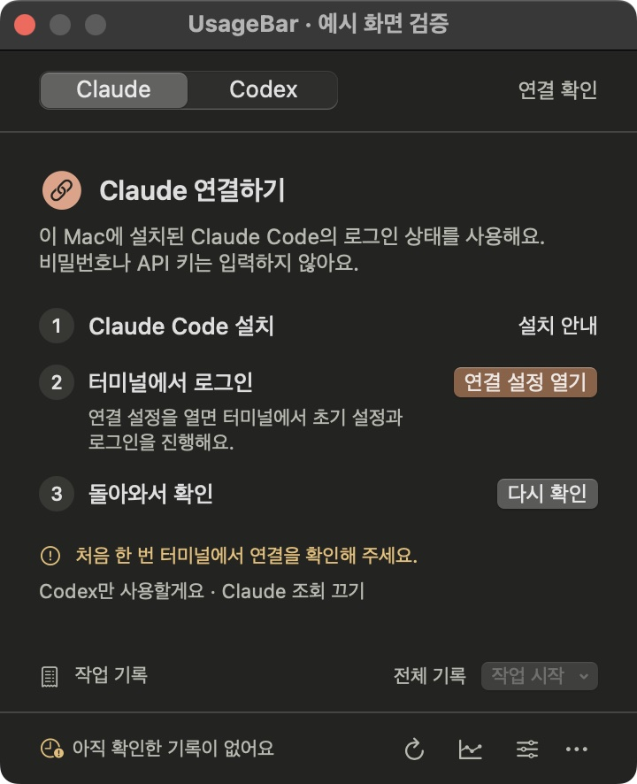
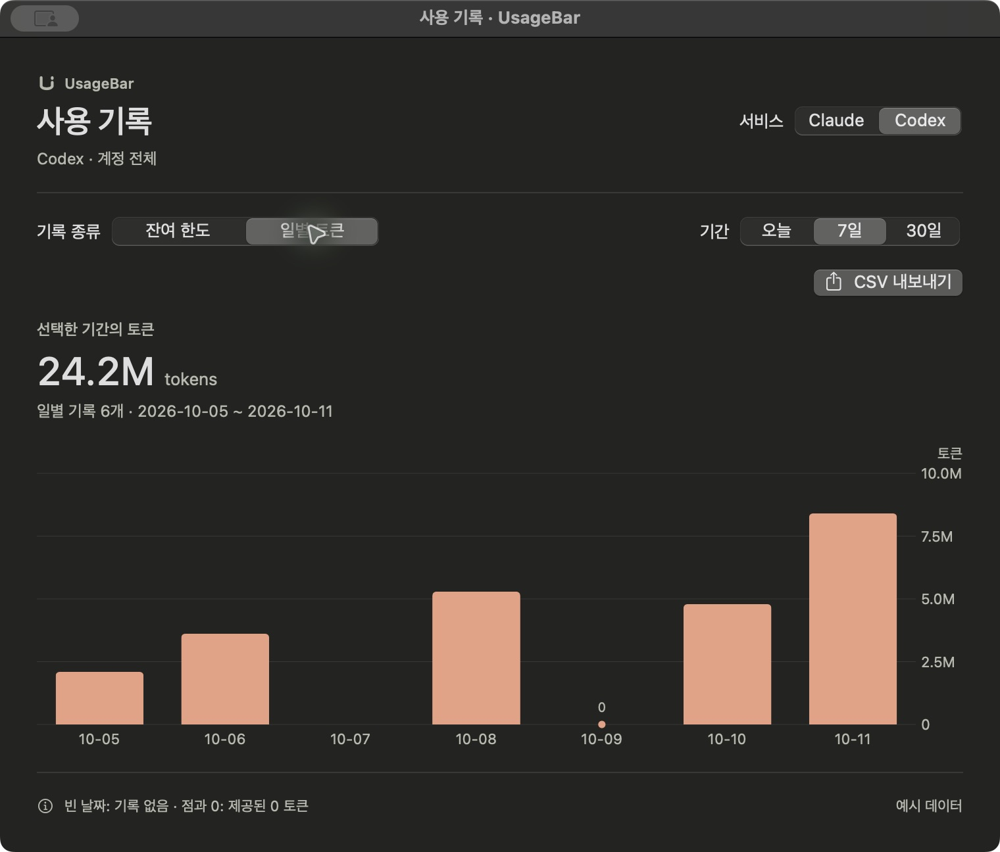
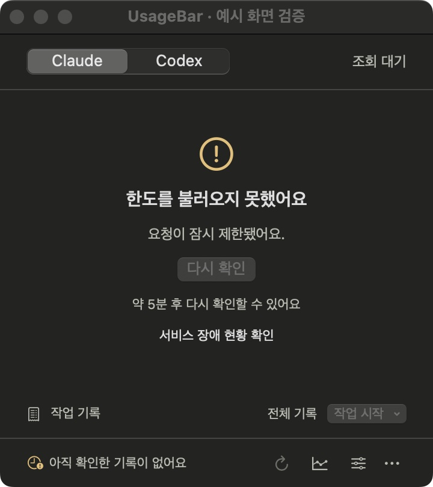

# UsageBar

*English: UsageBar is a macOS menu bar app that shows the remaining Claude Code and Codex subscription limits, when they reset, and how much a work session consumed. The interface is available in English and Korean and follows your system language. It uses the CLI logins already on your Mac and never asks for passwords or API keys.*



Claude와 Codex의 남은 한도를 확인하고, 작업을 마칠 때 한도 변화를 영수증으로 남기는 macOS 메뉴 막대 앱입니다. 기본은 Claude·다크 모드이며, 화면 상단의 **U 아이콘**을 눌러 사용합니다.

- **한도 게이지**: 남은 비율을 큰 숫자와 세그먼트 바로, 리셋 시각과 함께 확인합니다.
- **작업 기록**: 패널 아래 **작업 시작**에서 유형을 고르면 바로 시작하고, 종료 → 영수증 복사까지 한 줄에서 이어갑니다.
- **사용 기록**: 앱이 수집한 한도 변화와 제공되는 일별 토큰 기록을 조회하고 CSV로 내보냅니다.



*0.8에서 개편한 실제 앱 화면입니다. 모든 스크린샷은 예시 데이터를 사용하며 실계정 정보가 아닙니다. 대표 이미지는 메뉴바 패널과 같은 화면을 검증 창에 띄워 촬영했습니다.*

<details>
<summary>작업 영수증·사용 기록·설정 보기</summary>

**작업 영수증** — 작업을 끝내면 소요 시간과 계정 한도 변화를 함께 확인하고 요약을 복사할 수 있습니다.



**Codex 패널** — 초기화권과 일별 토큰까지 스크롤 없이 한 화면에 표시합니다.



**사용 기록** — 서비스·기간·한도별 변화를 살펴보고 현재 범위를 CSV로 내보냅니다. 관측값 사이는 가는 선으로 잇되, 90분 넘게 비면 끊어 표시합니다.



**설정** — 화면 모드, 메뉴 막대 표시, 로그인 시 실행, 알림과 조회할 서비스를 선택합니다.



</details>

## 다운로드·설치 — 이용자

**현재 저장소는 private이며 공개 다운로드는 아직 제공하지 않습니다.** 완성 후 이 저장소(`hyjoong/UsageBar`)를 public으로 전환해 **전체 소스 코드와 앱 릴리스**를 함께 공개할 예정입니다. 공개 전까지는 접근 권한이 있는 개발자가 소스에서 빌드하거나 이미 받은 `.app`을 사용할 수 있습니다.

### 공개 후 ZIP으로 설치하기

1. [GitHub Releases](https://github.com/hyjoong/UsageBar/releases)에서 최신 공개 릴리스의 `UsageBar-버전-빌드.zip`을 받습니다. GitHub가 자동으로 제공하는 **Source code** 파일은 앱 설치 파일이 아닙니다.
2. ZIP의 압축을 풀고, 나온 `UsageBar.app`을 아래 순서로 설치합니다.

현재 준비하는 배포본은 **macOS 14 이상·Apple Silicon(arm64)** 용입니다. Intel용 배포본은 아직 검증하지 않았습니다. 이 다운로드 절차는 저장소 공개와 릴리스 게시가 끝난 뒤 사용할 수 있습니다.

### 이미 빌드한 `UsageBar.app`이 있다면

1. UsageBar가 실행 중이면 상단 U 아이콘 → 더보기 → **UsageBar 종료**를 누릅니다.
2. Finder에서 `UsageBar.app`을 **응용 프로그램(Applications)** 폴더로 복사합니다. 이 프로젝트에서 직접 빌드한 파일은 `build/UsageBar.app`에 있습니다.
3. 응용 프로그램 폴더의 UsageBar를 엽니다.
4. 화면 상단 메뉴 막대에서 U 아이콘을 누릅니다. **별도 메인 창이나 Dock 아이콘이 뜨지 않는 것이 정상**입니다.

`.app`을 직접 실행할 수 있으므로 **DMG는 필수가 아닙니다.** 응용 프로그램 폴더에 두면 이후 실행과 로그인 시 자동 실행을 관리하기 편합니다. 소스의 기본 빌드는 ad hoc 서명을 사용하고, 공개 배포본은 Developer ID 서명·Apple 공증을 거친 ZIP으로 준비합니다.

### 소스에서 빌드한다면

필요한 환경:

- **macOS 14 이상**
- **Swift 5.10 이상을 지원하는 Xcode 또는 Command Line Tools** (영어 UI를 번들에 넣으려면 `xcstringstool`이 포함된 Xcode가 필요하고, 없으면 한국어만 들어간 앱이 만들어집니다)
- **Python 3** (빌드·배포 설정 검증에 사용)
- 공개 전에는 이 비공개 GitHub 저장소에 접근할 수 있는 계정

터미널에서 실행합니다. 현재는 GitHub 인증과 저장소 접근 권한이 필요하며, public 전환 후에는 누구나 소스를 내려받을 수 있습니다.

```sh
git clone --branch codex/initial https://github.com/hyjoong/UsageBar.git
cd UsageBar
zsh scripts/build-app.sh
open build/UsageBar.app
```

빌드 결과는 `build/UsageBar.app`입니다. UI 문자열은 `Resources/Localizable.xcstrings`에 있으며(원문 한국어, 영어 번역 포함) 빌드 스크립트가 `xcstringstool`로 번들에 컴파일합니다. `swift run`으로 바로 실행한 개발 바이너리는 번들이 없어 항상 한국어로 표시됩니다. 위의 Finder 설치 방법으로 응용 프로그램 폴더에 복사할 수 있습니다. 소스 저장소를 내려받는 것만으로 앱이 설치되지는 않습니다.

기본은 release 빌드이며 `zsh scripts/build-app.sh debug`로 디버그 앱을 만들 수 있습니다. 빌드 스크립트는 현재 Mac의 기본 아키텍처로 빌드합니다. 현재 확인한 로컬 결과물은 **Apple Silicon(arm64)** 용이며, Intel용 배포본은 아직 검증하지 않았습니다. 앱 내 업데이트에는 [Sparkle 2.10.0](https://github.com/sparkle-project/Sparkle/releases/tag/2.10.0)을 사용하며, 최초 빌드에는 패키지를 내려받을 인터넷 연결이 필요합니다.

### 새 버전으로 업데이트

0.7.0부터 앱 내 업데이트를 지원합니다. 최종 배포본은 **이 저장소의 GitHub Releases**에서 업데이트를 받도록 준비 중입니다. **지금은 저장소가 private이고 공개 릴리스가 없으므로, 주소가 설정된 앱에서도 업데이트를 내려받을 수 없습니다.** 저장소 공개와 릴리스 게시 후에는 다음 순서로 사용합니다.

1. U 아이콘 → **설정** → **앱 정보**에서 **업데이트 확인…**을 누릅니다. 창이 열린 상태에서는 앱 메뉴에서도 확인할 수 있습니다.
2. 새 버전이 있으면 변경 내용을 확인하고 설치합니다. 다운로드와 서명 확인 후 앱을 교체하고 재실행합니다.
3. **새 버전 자동 확인**을 켜면 주기적으로 확인합니다. 자동 설치는 하지 않으며, 백그라운드에서 발견한 업데이트는 메뉴바 패널 안에 표시합니다.

설정과 저장된 기록은 앱 밖에 보관되어 업데이트 후에도 유지됩니다. 진행 중인 작업을 자동으로 종료하지 않으며, 기록 저장 중에는 업데이트 재시작을 잠시 미룹니다. 업데이트 확인 실패나 서명 오류에서는 기존 앱을 계속 사용합니다.

0.6.4 이하에는 업데이트 기능이 없으므로 업데이트를 지원하는 배포본을 **한 번 직접 설치**해야 합니다. 소스 빌드는 저장소를 갱신한 뒤 빌드 명령을 다시 실행합니다. 배포 경로가 없는 개발용 빌드·일반 예시 모드는 실제 업데이트 서버에 접근하지 않습니다. 앱에는 비공개 저장소 접근용 GitHub 토큰을 포함하지 않습니다.

<details>
<summary>업데이트 설정 · 격리된 예시 앱</summary>


localhost에서 예시 빌드 100 → 101 설치·재실행을 검증한 화면입니다. 화면의 0.7.1은 테스트용 버전이며 실제 공개 배포 버전이 아닙니다. 계정 사용량은 모두 예시입니다.
</details>

## 처음 연결하기

UsageBar는 **이 Mac에 설치된 Claude Code·Codex CLI의 로그인 상태**를 사용합니다. UsageBar에 비밀번호나 API 키를 입력하지 않습니다. 먼저 사용하는 서비스의 CLI를 설치하고 구독 계정 로그인을 완료해 주세요.

처음 실행하면 패널에 연결 단계가 번호 순서로 표시됩니다. 한 서비스만 쓴다면 그 화면의 **…만 사용할게요** 링크로 다른 서비스의 조회를 바로 끌 수 있습니다.

<details>
<summary>첫 연결 화면 보기</summary>

</details>

### Claude

1. Claude Code CLI를 설치한 상태에서 UsageBar의 **Claude 연결 설정**을 누릅니다.
2. 열린 터미널에서 초기 설정과 구독 계정 로그인을 완료합니다. 화면 스타일·약관·폴더 확인이 나오면 내용을 확인하고 진행합니다.
3. 필요한 경우 Claude 안에서 `/login`을 실행하고, `/usage`에 사용량이 표시되는지 확인합니다.
4. 설정을 마친 뒤 해당 터미널 창을 닫고 UsageBar에서 **다시 확인**을 누릅니다.

연결 전용 폴더는 `~/Library/Application Support/UsageBar/ClaudeConnection`입니다. 연결 설정과 실제 조회는 같은 CLI 실행 파일을 사용하며, 확장 기능·도구·사용자 훅을 끈 옵션으로 실행합니다. CLI 명령에 관한 설명은 [Claude Code 공식 문서](https://code.claude.com/docs/en/interactive-mode)를 참고하세요.

### Codex

설치된 Codex CLI와 기존 **ChatGPT 구독 계정 로그인**을 사용합니다. 터미널에서 `codex --version`으로 CLI가 보이는지 확인하고, 로그인을 완료한 뒤 UsageBar에서 Codex를 선택해 다시 확인하세요. API 키로만 로그인한 계정의 청구 정보는 지원하지 않습니다.

UsageBar의 연결 프로토콜은 [Codex App Server 공식 문서](https://learn.chatgpt.com/docs/app-server)를 따릅니다. CLI 버전과 계정에 따라 제공되는 한도·초기화권·토큰 기록 항목이 다를 수 있습니다.

Claude만 사용한다면 **설정 → 연결 → Codex 사용량 조회**를 끄면 됩니다. 꺼 둔 서비스에는 조회 요청을 보내지 않으며 기존 기록과 한도 선택은 보존합니다. 최소 한 서비스는 켜 두어야 합니다.

<details>
<summary>연결 설정 화면 보기</summary>

설정을 아래로 스크롤하면 서비스별 조회 스위치와 마지막 성공 시각을 볼 수 있습니다. 아래는 외부 계정에 연결하지 않은 예시 화면입니다.


</details>

## 사용법

| 하고 싶은 일 | 조작 |
| --- | --- |
| 남은 한도 확인 | 상단 U 아이콘을 누릅니다. 큰 숫자는 고정한 한도의 **잔여율**이고, 바로 아래 바와 리셋 시각을 함께 봅니다. |
| 메뉴바에 표시할 한도 변경 | 한도 옆 **핀**을 누릅니다. 선택은 서비스별로 기억합니다. |
| Claude·Codex 함께 표시 | 설정 → 메뉴 막대 → **표시할 서비스**에서 **사용 중인 서비스 모두**를 선택합니다. 메뉴바에는 서비스 아이콘(✱ Claude, ▭ Codex)과 잔여율이 나란히 표시됩니다. |
| 패널을 창으로 띄우기 | 패널 하단 ⋯ 메뉴 → **창으로 열기**. 다른 창 위에 떠 있어 긴 작업 중에도 보이며, 닫으면 팝오버만 남습니다. |
| 메뉴바에 리셋 카운트다운 표시 | 설정 → **리셋까지 남은 시간도 표시**를 켭니다. |
| 작업 기록 시작·종료 | 패널 아래 **작업 시작**을 눌러 유형을 고르면 현재 한도를 확인하고 바로 시작합니다. 진행 중에는 경과 시간과 종료 버튼이 보이며, 종료 후 영수증을 복사하거나 ✕로 닫습니다. |
| 지난 영수증 확인 | 작업 기록 행의 **전체 기록**을 눌러 영수증을 보거나 복사·삭제합니다. |
| 사용량 변화 확인·내보내기 | **사용 기록**에서 서비스·기간·한도를 고르고 **CSV 내보내기**를 누릅니다. |
| 새 값 확인·설정 열기 | 패널 하단의 새로고침 아이콘이나 `⌘R`로 새로고침합니다. 설정 아이콘이나 `⌘,`로 설정을 열 수 있고 사용 기록·작업 영수증 창에서도 작동합니다. 앱 메뉴의 **설정…**에서도 열 수 있습니다. |
| 켤 때마다 자동 실행 | 설정 → **로그인 시 UsageBar 실행**을 켭니다. macOS 승인이 필요하면 안내에 따라 로그인 항목 설정을 확인합니다. |
| 화면 모드·알림 변경 | 설정에서 화면 모드와 **남은 한도가 20% 아래로 내려가면 알림**을 선택합니다. |

평소에는 사용량을 **5분마다** 확인합니다. 팝오버 바깥을 클릭하면 닫히며, 사용 기록·설정·전체 작업 영수증은 별도 창으로 엽니다.

### 작업 영수증 읽기

기능 개발·리팩터링·문제 해결·코드 리뷰·기타 작업 중 하나를 고르고 시작합니다. 한 번에 한 작업을 기록하며 **시작한 서비스는 끝날 때까지 유지**합니다. 중간에 패널에서 다른 서비스를 확인해도 기록 대상은 바뀌지 않습니다.

예를 들어 다음과 같이 표시됩니다. 아래 수치는 예시입니다.

> 리팩터링 · 42분
>
> 5시간 한도 +6%p · 주간 한도 +1%p

- 숫자는 관측 구간의 **계정 전체 사용률 변화**입니다. 다른 창·기기의 사용도 포함되며 특정 프로젝트의 사용량·토큰 수·결제 금액을 뜻하지 않습니다.
- `변화 없음`(0%p)은 **표시상 변화가 없음**을 뜻합니다. 실제 사용량이 0이라고 단정하지 않습니다.
- 시작과 종료에는 새로 성공한 조회값을 사용합니다. 조회 실패나 요청 제한 중에는 캐시를 새 측정값으로 기록하지 않습니다.
- 계정·플랜·한도 기간 변경, 리셋 경계 통과, 사용률 감소 등은 숫자 대신 비교 불가 사유를 표시합니다.
- 종료 조회가 실패하면 다시 시도하거나 **한도 비교 없이 종료**해 시간만 기록할 수 있습니다.
- 진행 중인 작업은 앱을 다시 켜도 이어집니다. 완료 영수증은 **최근 100개**를 보관하며 요약 복사와 개별 삭제를 지원합니다.

### 한도와 리셋 읽기

세그먼트 바는 **현재 남은 한도**를 20칸(5% 단위)으로 나타냅니다. 시간 흐름이나 사용 이력 그래프가 아닙니다. 20% 이하면 노란색, 오래된 기록이면 회색으로 바뀝니다. 보조 한도도 같은 바로 잔여율과 리셋 시각을 확인합니다.

오래된 값은 **이전 기록**으로 표시합니다. 리셋 시간이 지나도 새 조회가 성공하기 전에는 잔여율을 100%로 바꾸지 않습니다. `사용 속도`는 기간 경과율과 한도 사용률을 비교한 참고값이며, 미래 사용량을 보장하는 예측은 아닙니다.

### 일별 토큰 기록 읽기

Codex가 제공한 일별 기록은 **오늘을 포함한 달력 날짜**로 표시합니다. 날짜가 비어 있어도 그래프의 하루 간격은 유지합니다. 빈 날짜는 기록 없음, 점과 `0`은 제공자가 반환한 0토큰을 뜻합니다. 합계와 CSV에는 제공된 기록만 포함합니다. 현재 UsageBar의 Claude 연결은 일별 토큰 기록을 지원하지 않습니다.

<details>
<summary>누락 날짜와 0토큰 구분 · 예시 데이터</summary>

</details>

## 문제가 생겼을 때

| 증상 | 확인할 내용 |
| --- | --- |
| 실행했는데 창이 안 보여요 | 메뉴바 앱입니다. 화면 상단 U 아이콘을 찾으세요. 다른 메뉴바 관리 앱을 사용한다면 숨겨진 항목도 확인하세요. |
| CLI를 찾지 못해요 | 해당 CLI가 설치되어 있는지 확인합니다. Claude는 `~/.local/bin` → `/opt/homebrew/bin` → `/usr/local/bin` → 절대 경로로 된 `PATH` 순서로 찾으며, Codex는 `PATH`와 일반적인 설치 위치를 확인합니다. |
| 로그인이 필요하다고 나와요 | Claude 연결 설정이나 해당 CLI에서 로그인·초기 설정을 마친 뒤 **다시 확인**합니다. UsageBar는 로그인 화면을 대신 처리하지 않습니다. |
| 이전 기록이나 조회 오류가 보여요 | 마지막 성공 조회값일 수 있습니다. 인터넷과 CLI 로그인 상태를 확인한 뒤 새로고침합니다. 더보기 메뉴에서는 공식 서비스 장애 현황도 열 수 있습니다. |
| 새로고침이 잠겨 있어요 | 서비스가 요청을 제한하면 **다시 확인할 수 있는 시간**을 안내합니다. 해당 시간까지 기다려 주세요. 서비스를 껐다 켜도 대기 시간은 유지됩니다. |
| 작업 종료 조회가 실패해요 | 기록은 진행 상태로 유지됩니다. 재시도하거나 **한도 비교 없이 종료**할 수 있습니다. |
| 새 버전으로 바꾸고 싶어요 | 업데이트가 설정된 0.7.0 이상 배포본은 설정 → 앱 정보 → **업데이트 확인…**을 누릅니다. 0.6.4 이하나 배포 경로가 없는 개발용 앱은 종료 후 새 `.app`으로 교체합니다. |
| 업데이트 확인이 404로 실패해요 | 현재는 저장소와 준비 중인 릴리스가 비공개입니다. 공개 전환과 릴리스 게시 전에는 업데이트를 받을 수 없습니다. 공개 후에도 계속되면 Releases에 해당 버전이 게시되었는지 확인하세요. |
| 기록이 사라질까 걱정돼요 | 기록은 `.app` 밖의 Application Support 폴더에 저장됩니다. 앱 교체만으로 삭제되지 않습니다. 문제 해결을 위해 이 폴더를 지우기 전에 필요한 파일을 백업하세요. |

최초 조회에서 요청 제한이 발생하면 존재하지 않는 이전 값을 표시하지 않고, 재시도 대기 시간을 안내합니다. 일시적인 조회 실패에서는 설치 안내를 숨기고, 로그인·초기 설정이 필요한 경우에 연결 설정을 표시합니다.

<details>
<summary>요청 제한 화면 · 예시 데이터</summary>

</details>

## 지원 범위와 개인정보

| 서비스 | 표시하는 정보 | 제한 |
| --- | --- | --- |
| Claude | CLI `/usage`에 표시되는 세션·주간·모델 범위별 한도와 리셋 안내 | CLI 화면 형식에 의존합니다. 날짜를 해석하지 못하면 확인 가능한 원문 리셋 안내를 표시합니다. 일별 토큰 기록은 제공하지 않습니다. |
| Codex | App Server가 반환한 한도별 사용률·기간·리셋 시각, 저장된 초기화권 개수와 만료일, 일별 토큰 기록 | CLI 버전과 계정 응답에 따라 항목이 없을 수 있습니다. 초기화권 상세가 없어도 개수는 표시할 수 있습니다. |

미제공 값은 0으로 바꾸지 않습니다. **구독 종료일·다음 결제일·실제 청구액·프로젝트별 비용은 표시하지 않으며 초기화권을 소비하는 기능도 없습니다.** 사용 기록의 한도 변화는 앱이 실행되며 수집한 표본으로, Codex의 일별 토큰 기록과는 별개입니다.

Claude는 기존 로그인 상태로 CLI의 `/usage`를 실행합니다. Codex는 전용 자식 프로세스의 stdio 연결에서 `account/read`, `account/rateLimits/read`, `account/usage/read`를 읽습니다. 모델 작업을 요청하거나 OAuth 엔드포인트·Keychain을 직접 읽지 않습니다. 인증과 갱신은 각 CLI가 관리합니다.

표시용 메타데이터와 작업 기록은 이 Mac의 다음 파일에 저장합니다.

```text
~/Library/Application Support/UsageBar/usage-cache.json
~/Library/Application Support/UsageBar/work-journal.json
```

- 한도 변화 표본: 최근 30일, 전체 최대 60,000개·일별 최대 2,500개. 마지막 성공 조회 결과도 캐시합니다.
- 계정 구분: 해시된 식별자를 사용하며 계정 변경을 식별하면 이전 변화 기록을 분리합니다.
- 작업 기록: 진행 중인 체크포인트에는 계정 일치 확인용 해시만 보관하고 완료 영수증에서는 제거합니다.
- **원본 이메일·인증 토큰·대화 내용·프로젝트 파일·CLI 원문 응답은 저장하지 않습니다.** CSV에는 선택한 범위의 날짜·한도 이름·수치만 포함합니다.

## 개발

SwiftUI·AppKit·Swift Charts와 Swift Package Manager를 사용합니다.

```sh
swift build
swift test
swift run UsageBar --demo
```

`--demo`는 CLI 조회와 사용 기록 캐시 접근 없이 예시 데이터로 메뉴바 화면을 보여줍니다. 일반 실행은 실제 계정을 조회합니다. 일반 사용자에게는 연결 리소스를 포함하는 `scripts/build-app.sh`로 만든 앱 실행을 권장합니다.

Debug 빌드에는 다음 화면 확인 옵션이 있습니다. Release 빌드에는 포함되지 않습니다.

| 옵션 | 확인할 화면 |
| --- | --- |
| `--demo --ui-check` | 메뉴바 패널을 담은 검증 창 |
| `--demo --ui-check --ui-codex` | Codex를 선택한 패널 (초기화권·일별 토큰 포함) |
| `--demo --ui-check --ui-journal-active` | 진행 중인 작업 기록 카드 |
| `--demo --ui-check --ui-journal-receipt` | 방금 완료한 작업 영수증 카드 |
| `--demo --ui-window` | 패널을 떠 있는 창으로 연 상태 |
| `--demo --ui-menu-all` | 메뉴바에 두 서비스를 함께 표시 |
| `--demo --ui-settings` | 설정 창 |
| `--demo --ui-history` | 사용 기록 창 |
| `--demo --ui-history --ui-history-gaps --ui-history-tokens` | Codex 일별 토큰 탭에서 누락일과 명시적인 0토큰 비교 |
| `--demo --ui-work-journal` | 작업 영수증 창 |
| `--demo --ui-check --ui-work-failure` | 작업 시작 후 종료 조회 실패·재시도·한도 비교 없이 종료 |
| `--demo --ui-check --ui-stale` | 오래된 낮은 잔여율과 이전 기록 안내 |
| `--demo --ui-check --ui-reset-due` | 리셋 시각이 지났지만 새 값은 확인하지 못한 상태 |
| `--demo --ui-check --ui-rate-limited` | 저장된 값 없이 요청 제한이 발생한 상태 |
| `--demo --ui-check --ui-connection-required` | 로그인·초기 연결 설정이 필요한 상태 |
| 위 옵션에 `--ui-light` 또는 `--ui-dark` 추가 | 예시 앱의 밝은 모드 또는 어두운 모드 |
| 빌드한 `.app`에 `-AppleLanguages '(en)'` 추가 | 영어 UI (번들의 `en.lproj` 필요) |

배포·공증 절차와 버전별 검증 기록은 [docs/RELEASING.md](docs/RELEASING.md), 디자인 방향과 참고한 제품은 [docs/DESIGN.md](docs/DESIGN.md), 변경 이력은 [CHANGELOG.md](CHANGELOG.md)에 있습니다.
