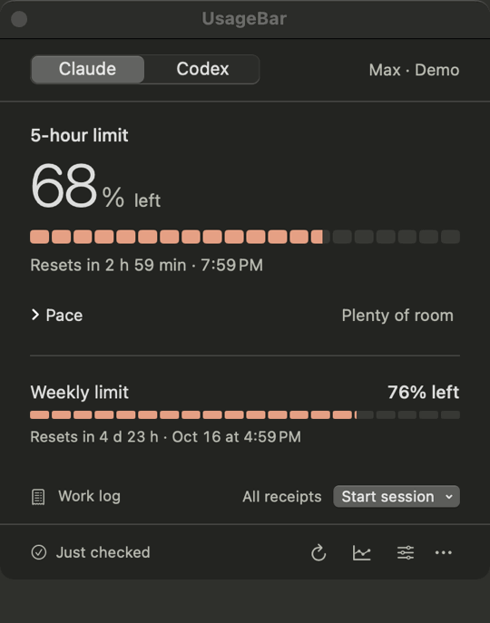
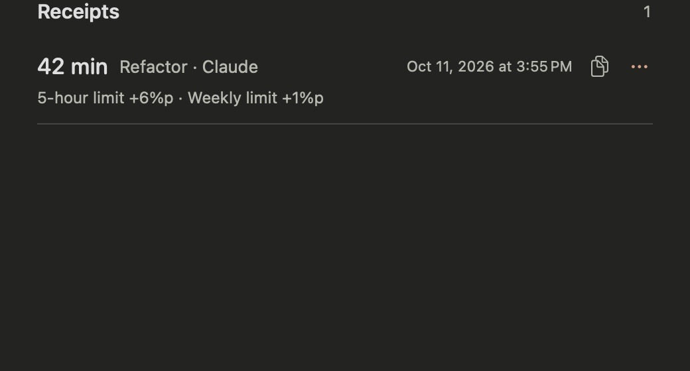
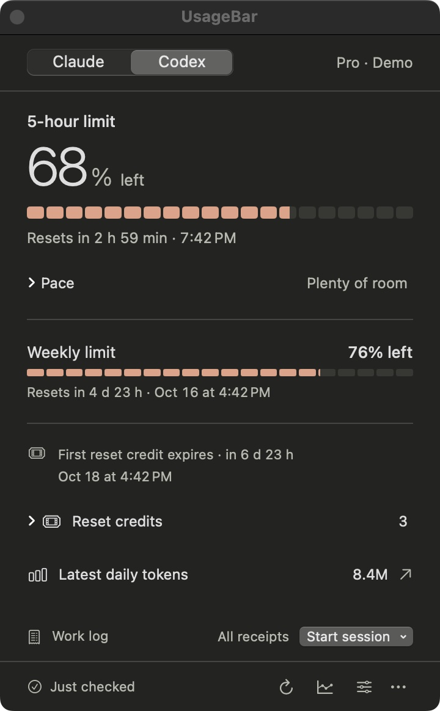
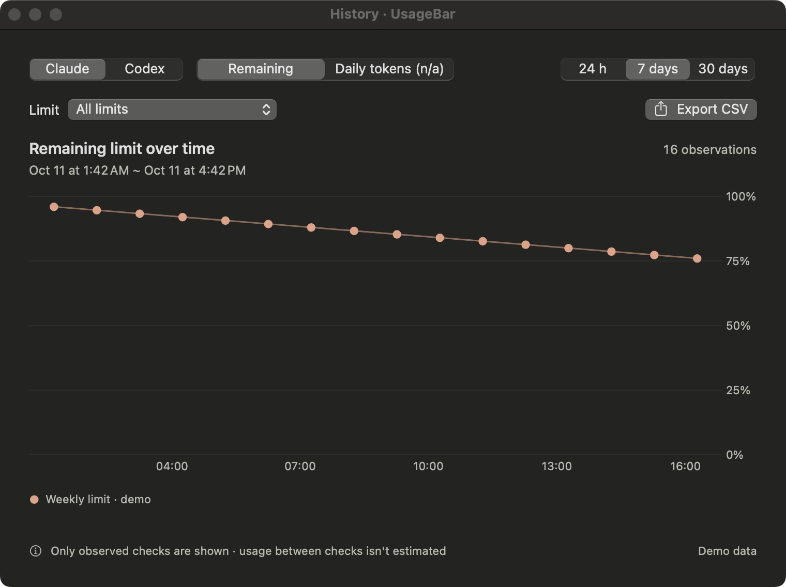
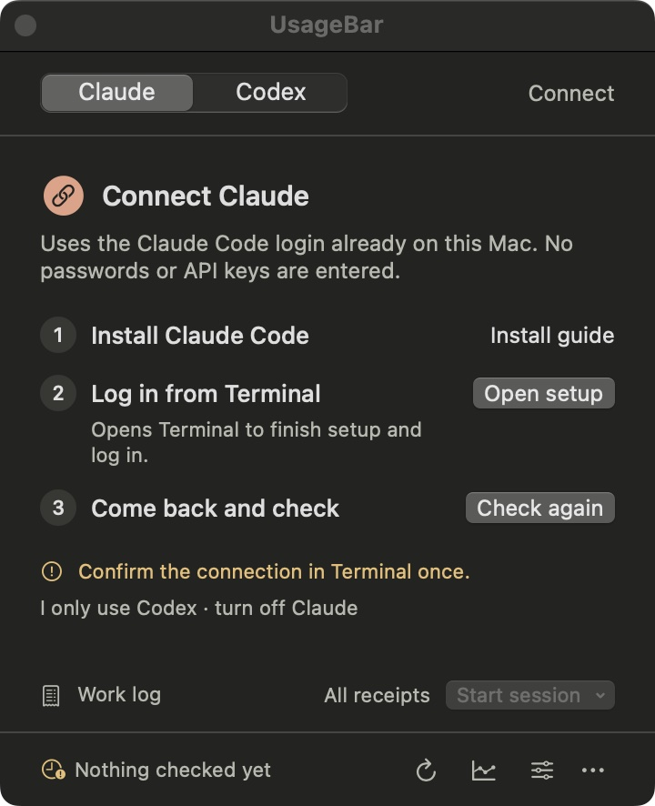

<p align="center">
  
</p>

<h1 align="center">UsageBar</h1>

<p align="center">
  A receipt for every work session: how much of your Claude Code or Codex limit it used.<br />
  Plus the remaining limits and reset times, always in your Mac's menu bar.
</p>

<p align="center">
  <a href="https://github.com/hyjoong/UsageBar/releases"></a>
  
  
  
  <a href="https://github.com/hyjoong/UsageBar/actions/workflows/ci.yml"></a>
  <a href="LICENSE"></a>
</p>

<p align="center">
  <a href="#install">Install</a> ·
  <a href="#features">Features</a> ·
  <a href="#usage">Usage</a> ·
  <a href="#faq">FAQ</a> ·
  <a href="#privacy">Privacy</a> ·
  <a href="#license">License</a> ·
  <a href="README.ko.md">한국어</a>
</p>

<p align="center">
  
</p>

## Features

- **Work receipts.** Pick a session type, do your work, press Finish. The receipt tells you how long it took and how many percentage points of each limit it used. No other menu bar app answers "what did this refactor cost me?"
- **At a glance.** The 5-hour limit as a big number and a 20-segment gauge, with the exact reset time. The weekly limit follows below. The menu bar shows the percentage all the time.
- **History.** Remaining limits over time and Codex daily tokens as charts, exportable to CSV.
- **Both services.** Claude Code and Codex side by side, or just the one you use.
- **Nothing new to log in to.** UsageBar reads the CLI logins already on your Mac. It never asks for a password or an API key.
- **Stays out of the way.** A menu bar popover that sizes to its content, a floating window when you want it to stay visible, and optional notifications when a limit drops below 20% and when a low limit resets.
- **English and Korean.** Follows your system language.

<p align="center">
  
  
  
</p>

<p align="center"><sub>Receipts · Codex panel · History. All screenshots use demo data.</sub></p>

## Install

**Requirements:** macOS 14 or later on Apple Silicon, and the [Claude Code](https://code.claude.com/docs/en/quickstart) or [Codex](https://github.com/openai/codex) CLI logged in with a subscription account.

**Homebrew**

```sh
brew install --cask hyjoong/tap/usagebar
```

**Manual**

1. Download `UsageBar-<version>-<build>.zip` from the [latest release](https://github.com/hyjoong/UsageBar/releases/latest). The automatic *Source code* archives are not the app.
2. Unzip it and move `UsageBar.app` to **Applications**.

Then open it and click the **U** icon in the menu bar. There is no main window or Dock icon.

The app is signed with a Developer ID and notarized by Apple. Updates install in place from Settings → About → **Check for Updates…**; settings and history are kept.

## Connect your accounts

On first launch the panel walks you through the connection in three numbered steps. If you only use one service, the **I only use …** link turns the other one off.

<p align="center">
  
</p>

| Service | What to do |
| --- | --- |
| **Claude** | Install the Claude Code CLI, press **Open setup** to finish setup and log in from Terminal, then press **Check again**. |
| **Codex** | Install the Codex CLI, run `codex login` with your ChatGPT subscription account, then press **Check again**. API key billing is not supported. |

## Usage

| I want to… | Do this |
| --- | --- |
| See remaining limits | Click the U icon. The big number is the 5-hour limit; other limits follow below. |
| Record a session | Choose a type under **Start session**. Finishing records the duration and the limit change in percentage points. **All receipts** lets you copy or delete them. |
| Review or export history | Click the history icon at the bottom, choose service, period and limit, then **Export CSV**. |
| Keep the panel visible | ⋯ menu → **Open as Window**. The window floats above others. Launching the app again opens the same window. |
| Show both services in the menu bar | Settings → Menu Bar → **Show services** → **All enabled services**. |
| Launch at login, low-limit alerts | Settings → **Launch UsageBar at login**, **Notify when a limit drops below 20%**. |

**How to read a receipt.** The numbers are the *account-wide* change over the observed interval. They include other windows and devices and are not a project's token count or cost. When a reset or an account or plan change makes the comparison meaningless, the receipt says why instead of showing a number.

## FAQ

**The icon is not in my menu bar.**
When the menu bar is full, macOS hides items that fall under the notch, and a newly added app lands right next to it. Remove a few Control Center items or use a menu bar manager; then ⌘-drag the U icon to the right so it keeps its spot. Until then, launching UsageBar again opens the panel as a window.

**It says a login is needed.**
Log in with the CLI in Terminal, then press **Check again**. UsageBar never handles the login itself.

**It shows "earlier record" or an error.**
That is the last successful check. Verify your internet connection and the CLI login, then refresh. The ⋯ menu links to each service's status page.

**Refresh is greyed out.**
The service is rate limiting requests. UsageBar shows when it can check again.

**Does it work on Intel Macs?**
Releases are built for Apple Silicon. Intel builds have not been tested.

## Privacy

- UsageBar uses each CLI's existing login. It never asks for, stores, or transmits passwords, API keys or tokens.
- Usage history and receipts live only in `~/Library/Application Support/UsageBar/`. Conversations, project files and raw CLI responses are not stored.
- Billing dates, amounts and per-project costs are not shown, and nothing consumes reset credits.
- No analytics, no telemetry. The only network activity is the CLIs' own usage queries and the signed update check you can turn off.

Details are in [docs/PRIVACY.md](docs/PRIVACY.md) (Korean).

## Development

```sh
git clone https://github.com/hyjoong/UsageBar.git
cd UsageBar
swift build && swift test
swift run UsageBar --demo      # demo data, no account access
zsh scripts/build-app.sh       # signed .app in build/
```

SwiftUI, AppKit and Swift Charts on Swift Package Manager; in-app updates via [Sparkle](https://sparkle-project.org). UI strings live in `Resources/Localizable.xcstrings` (Korean source, English translations). The source build, demo screens, release process, design notes and changelog are documented in [docs/](docs/) and [CHANGELOG.md](CHANGELOG.md).

Bug reports and pull requests are welcome. If the installed CLI's output or protocol changes, the provider code in `Sources/UsageBarCore` is the place to look.

## License

[MIT](LICENSE) © 2026 Hyunjoong Kim. In-app updates use [Sparkle](https://sparkle-project.org), whose license ships inside the app bundle.
