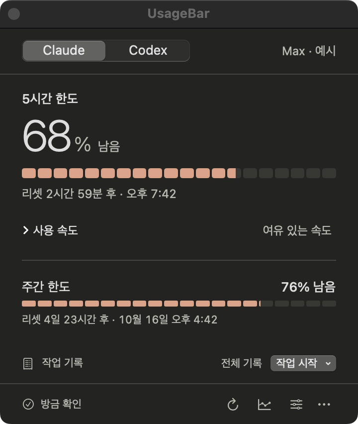

# UsageBar

Claude Code와 Codex의 남은 구독 한도를 메뉴 막대에서 확인하는 macOS 앱입니다. 작업을 시작하고 끝낼 때 한도가 얼마나 줄었는지 영수증으로 남길 수 있습니다.

[English](README.en.md)

<p align="center">
  
</p>

- **한눈에**: 5시간 한도의 잔여율을 큰 숫자와 게이지로, 리셋 시각과 함께 봅니다. 주간 한도는 아래에 이어집니다.
- **작업 영수증**: **작업 시작**에서 유형을 고르면 바로 시작하고, 끝낼 때 소요 시간과 한도 변화가 남습니다.
- **사용 기록**: 한도 변화 추이와 Codex 일별 토큰을 차트로 보고 CSV로 내보냅니다.
- **그대로 로그인**: 이 Mac에 설치된 Claude Code·Codex CLI의 로그인 상태를 사용합니다. 비밀번호나 API 키를 입력하지 않습니다.

<p align="center">
  
  
  
</p>

<sub>Codex 패널 · 작업 영수증 · 사용 기록. 모든 스크린샷은 예시 데이터입니다.</sub>

## 설치

macOS 14 이상, Apple Silicon.

1. [Releases](https://github.com/hyjoong/UsageBar/releases)에서 `UsageBar-버전-빌드.zip`을 받습니다. GitHub가 자동으로 붙이는 **Source code**는 설치 파일이 아닙니다.
2. 압축을 풀고 `UsageBar.app`을 **응용 프로그램** 폴더로 옮긴 뒤 엽니다.
3. 메뉴 막대의 **U** 아이콘을 누릅니다. 별도 창이나 Dock 아이콘은 뜨지 않습니다.

새 버전은 설정 → 앱 정보 → **업데이트 확인…**으로 설치합니다. 설정과 기록은 유지됩니다.

## 처음 연결하기

처음 실행하면 패널이 연결 단계를 번호 순서로 안내합니다. 한 서비스만 쓴다면 **…만 사용할게요** 링크로 다른 서비스 조회를 끌 수 있습니다.

<p align="center">
  
</p>

- **Claude**: Claude Code CLI를 설치한 뒤 **연결 설정 열기**를 누르면 터미널이 열립니다. 초기 설정과 구독 계정 로그인을 마치고 **다시 확인**을 누릅니다.
- **Codex**: Codex CLI를 설치하고 터미널에서 `codex login`으로 ChatGPT 구독 계정에 로그인한 뒤 **다시 확인**을 누릅니다. API 키 계정의 요금은 지원하지 않습니다.

## 사용법

| 하고 싶은 일 | 조작 |
| --- | --- |
| 남은 한도 확인 | U 아이콘을 누릅니다. 큰 숫자는 5시간 한도의 잔여율이고, 주간 등 다른 한도는 아래에 이어집니다. |
| 작업 영수증 남기기 | **작업 시작**에서 유형을 고릅니다. 끝내면 소요 시간과 한도 변화(%p)가 남고, **전체 기록**에서 복사·삭제합니다. |
| 사용량 변화 확인·내보내기 | 하단 기록 아이콘 → 서비스·기간·한도를 고르고 **CSV 내보내기**. |
| 패널을 창으로 띄우기 | ⋯ 메뉴 → **창으로 열기**. 다른 창 위에 떠 있어 긴 작업 중에도 보입니다. 앱을 다시 실행해도 같은 창이 열립니다. |
| Claude·Codex 함께 표시 | 설정 → 메뉴 막대 → **표시할 서비스** → **사용 중인 서비스 모두**. |
| 로그인 시 실행·알림 | 설정 → **로그인 시 UsageBar 실행**, **남은 한도가 20% 아래로 내려가면 알림**. |

영수증의 숫자는 관측 구간의 **계정 전체 사용률 변화**입니다. 다른 창이나 기기의 사용도 포함되며, 특정 프로젝트의 토큰 수나 비용이 아닙니다. 리셋을 지나거나 계정·플랜이 바뀌어 비교할 수 없으면 사유를 표시합니다.

## 문제가 생겼을 때

| 증상 | 확인할 내용 |
| --- | --- |
| 아이콘이 안 보여요 | 메뉴 막대가 꽉 차면 macOS가 노치 아래 아이템을 숨깁니다. 제어 센터 항목을 줄이거나 메뉴 막대 정리 앱을 쓰세요. 그 사이에는 UsageBar를 다시 실행하면 패널 창이 열립니다. |
| 로그인이 필요하다고 나와요 | 터미널에서 해당 CLI 로그인을 마친 뒤 **다시 확인**을 누릅니다. |
| 이전 기록·조회 오류가 보여요 | 마지막 성공값입니다. 인터넷과 CLI 로그인 상태를 확인한 뒤 새로고침하세요. ⋯ 메뉴에서 서비스 장애 현황을 열 수 있습니다. |
| 새로고침이 잠겨 있어요 | 서비스가 요청을 제한한 상태입니다. 안내된 시간까지 기다려 주세요. |

## 개인정보

- 각 CLI의 기존 로그인을 사용하며 비밀번호·API 키·토큰을 입력받거나 저장하지 않습니다.
- 사용량 기록과 작업 영수증은 `~/Library/Application Support/UsageBar/`에만 저장됩니다. 대화 내용, 프로젝트 파일, CLI 원문 응답은 저장하지 않습니다.
- 구독 종료일·결제액·프로젝트별 비용은 표시하지 않으며 초기화권을 소비하는 기능도 없습니다.

상세는 [docs/PRIVACY.md](docs/PRIVACY.md)에 있습니다.

## 개발

```sh
swift build && swift test
swift run UsageBar --demo
```

소스 빌드와 화면 확인 옵션은 [docs/DEVELOPMENT.md](docs/DEVELOPMENT.md), 배포·공증 절차는 [docs/RELEASING.md](docs/RELEASING.md), 디자인 참고는 [docs/DESIGN.md](docs/DESIGN.md), 변경 이력은 [CHANGELOG.md](CHANGELOG.md)에 있습니다.
