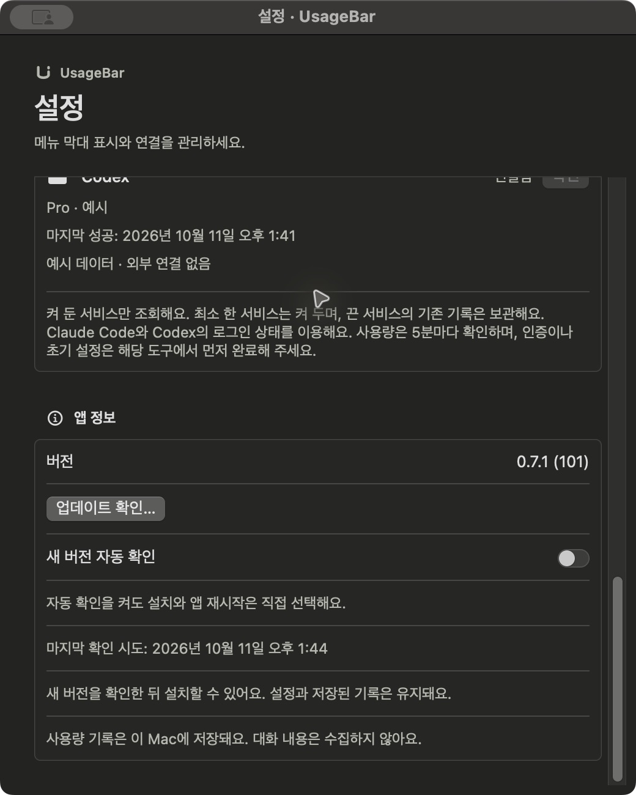

# 개발과 소스 빌드

## 소스에서 빌드하기

필요한 환경:

- **macOS 14 이상**
- **Swift 5.10 이상을 지원하는 Xcode 또는 Command Line Tools** (영어 UI를 번들에 넣으려면 `xcstringstool`이 포함된 Xcode가 필요하고, 없으면 한국어만 들어간 앱이 만들어집니다)
- **Python 3** (빌드·배포 설정 검증에 사용)
- 공개 전에는 이 비공개 GitHub 저장소에 접근할 수 있는 계정

터미널에서 실행합니다. 현재는 GitHub 인증과 저장소 접근 권한이 필요하며, public 전환 후에는 누구나 소스를 내려받을 수 있습니다.

```sh
git clone https://github.com/hyjoong/UsageBar.git
cd UsageBar
zsh scripts/build-app.sh
open build/UsageBar.app
```

빌드 결과는 `build/UsageBar.app`입니다. UI 문자열은 `Resources/Localizable.xcstrings`에 있으며(원문 한국어, 영어 번역 포함) 빌드 스크립트가 `xcstringstool`로 번들에 컴파일합니다. `swift run`으로 바로 실행한 개발 바이너리는 번들이 없어 항상 한국어로 표시됩니다. 위의 Finder 설치 방법으로 응용 프로그램 폴더에 복사할 수 있습니다. 소스 저장소를 내려받는 것만으로 앱이 설치되지는 않습니다.

기본은 release 빌드이며 `zsh scripts/build-app.sh debug`로 디버그 앱을 만들 수 있습니다. 빌드 스크립트는 현재 Mac의 기본 아키텍처로 빌드합니다. 현재 확인한 로컬 결과물은 **Apple Silicon(arm64)** 용이며, Intel용 배포본은 아직 검증하지 않았습니다. 앱 내 업데이트에는 [Sparkle 2.10.0](https://github.com/sparkle-project/Sparkle/releases/tag/2.10.0)을 사용하며, 최초 빌드에는 패키지를 내려받을 인터넷 연결이 필요합니다.

## 개발 환경

SwiftUI·AppKit·Swift Charts와 Swift Package Manager를 사용합니다.

```sh
swift build
swift test
swift run UsageBar --demo
```

`--demo`는 CLI 조회와 사용 기록 캐시 접근 없이 예시 데이터로 메뉴바 화면을 보여줍니다. 일반 실행은 실제 계정을 조회합니다. 일반 사용자에게는 연결 리소스를 포함하는 `scripts/build-app.sh`로 만든 앱 실행을 권장합니다.

Debug 빌드에는 다음 화면 확인 옵션이 있습니다. Release 빌드에는 포함되지 않습니다.

| 옵션 | 확인할 화면 |
| --- | --- |
| `--demo --ui-check` | 메뉴바 패널을 담은 검증 창 |
| `--demo --ui-check --ui-codex` | Codex를 선택한 패널 (초기화권·일별 토큰 포함) |
| `--demo --ui-check --ui-journal-active` | 진행 중인 작업 기록 카드 |
| `--demo --ui-check --ui-journal-receipt` | 방금 완료한 작업 영수증 카드 |
| `--demo --ui-check --ui-journal-receipt-reset` | 리셋을 지나 한도 비교가 안 되는 영수증 (토큰이 헤드라인) |
| `--demo --ui-window` | 패널을 떠 있는 창으로 연 상태 |
| `--demo --ui-menu-all` | 메뉴바에 두 서비스를 함께 표시 |
| `--demo --ui-window --ui-demo-flow` | 클릭 없이 작업 시작 → 진행 → 영수증까지 자동 진행 (README GIF 녹화용, `scripts/record-demo-flow.sh`) |
| `--demo --ui-settings` | 설정 창 |
| `--demo --ui-history` | 사용 기록 창 |
| `--demo --ui-history --ui-history-gaps --ui-history-tokens` | Codex 일별 토큰 탭에서 누락일과 명시적인 0토큰 비교 |
| `--demo --ui-work-journal` | 작업 영수증 창 |
| `--demo --ui-check --ui-work-failure` | 작업 시작 후 종료 조회 실패·재시도·한도 비교 없이 종료 |
| `--demo --ui-check --ui-stale` | 오래된 낮은 잔여율과 이전 기록 안내 |
| `--demo --ui-check --ui-reset-due` | 리셋 시각이 지났지만 새 값은 확인하지 못한 상태 |
| `--demo --ui-check --ui-rate-limited` | 저장된 값 없이 요청 제한이 발생한 상태 |
| `--demo --ui-check --ui-connection-required` | 로그인·초기 연결 설정이 필요한 상태 |
| `--demo --ui-check --ui-auth-required` | 로그인 만료 복구 카드: Claude는 이전 기록 위에, Codex는 첫 조회에서 |
| `--demo --ui-check --ui-codex-setup-error` | Codex 실행 실패: 다시 연결 버튼과 23시간 전 100% 기록을 현재 한도와 구분 |
| 위 옵션에 `--ui-light` 또는 `--ui-dark` 추가 | 예시 앱의 밝은 모드 또는 어두운 모드 |
| 빌드한 `.app`에 `-AppleLanguages '(en)'` 추가 | 영어 UI (번들의 `en.lproj` 필요) |

배포·공증 절차와 버전별 검증 기록은 [docs/RELEASING.md](docs/RELEASING.md), 디자인 방향과 참고한 제품은 [docs/DESIGN.md](docs/DESIGN.md), 변경 이력은 [CHANGELOG.md](CHANGELOG.md)에 있습니다.

## Codex 실행 실패와 이전 기록

Finder에서 실행한 앱은 터미널과 `PATH`가 다를 수 있습니다. npm으로 설치한 `codex` 파일이 있어도 `/usr/bin/env node`가 Node를 찾지 못하면 버전 확인 단계부터 실패합니다. 자동 탐색에서는 후보마다 `--version` 실행을 검증하고, 실패한 후보는 건너뛰어 Codex·ChatGPT 앱에 포함된 실행 파일까지 확인합니다. 버전 확인을 통과한 후보가 여럿이면 가장 높은 버전을 씁니다. 오래된 CLI(예: nvm 전역의 0.46)는 `--version`에는 답하지만 `app-server`의 사용량 메서드를 지원하지 않아, 먼저 찾았다는 이유로 고르면 조회가 계속 실패합니다. 첫 후보를 찾은 뒤의 검사는 1초 이내로 짧게 하고 사용량 조회에 8초를 남깁니다. 같은 파일을 가리키는 심볼릭 링크는 한 번만 검사하며 전체 조회 시간 제한과 취소를 유지합니다. 코드에서 명시한 실행 파일 경로는 다른 후보로 대체하지 않습니다.

실행 실패 화면의 **Codex 다시 연결**은 설치된 실행 파일을 다시 탐색하고 사용량을 조회합니다. 로그인 오류에는 기존 로그인 안내를, 실행 오류에는 설치·업데이트 안내를 표시합니다. 조회에 실패했을 때 기존 한도를 100%로 초기화하지 않으며, 저장된 값은 **마지막 확인 시 …% 남음**과 조회 시점으로 구분합니다.

한국어·영어 화면 확인에는 `--demo --ui-check --ui-codex-setup-error`(23시간 전 100% 기록)와 `--demo --ui-check --ui-codex --ui-connection-required`(첫 조회 실패)를 사용합니다. 실제 복구 검증에서는 새 debug 빌드를 Finder로 열고 **Codex 다시 연결** 후 최신 값으로 바뀌는지 확인합니다. 소스 수정만으로 설치된 앱에 반영되지는 않습니다.

## 앱 내 업데이트 동작

0.7.0부터 앱 내 업데이트를 지원합니다. 최종 배포본은 **이 저장소의 GitHub Releases**에서 업데이트를 받도록 준비 중입니다. **지금은 저장소가 private이고 공개 릴리스가 없으므로, 주소가 설정된 앱에서도 업데이트를 내려받을 수 없습니다.** 저장소 공개와 릴리스 게시 후에는 다음 순서로 사용합니다.

1. 메뉴 막대의 잔여율 → 톱니바퀴 → **설정** → **앱 정보**에서 **업데이트 확인…**을 누릅니다. 창이 열린 상태에서는 앱 메뉴에서도 확인할 수 있습니다.
2. 새 버전이 있으면 변경 내용을 확인하고 설치합니다. 다운로드와 서명 확인 후 앱을 교체하고 재실행합니다.
3. **새 버전 자동 확인**을 켜면 주기적으로 확인합니다. 자동 설치는 하지 않으며, 백그라운드에서 발견한 업데이트는 메뉴바 패널 안에 표시합니다.

설정과 저장된 기록은 앱 밖에 보관되어 업데이트 후에도 유지됩니다. 진행 중인 작업을 자동으로 종료하지 않으며, 기록 저장 중에는 업데이트 재시작을 잠시 미룹니다. 업데이트 확인 실패나 서명 오류에서는 기존 앱을 계속 사용합니다.

0.6.4 이하에는 업데이트 기능이 없으므로 업데이트를 지원하는 배포본을 **한 번 직접 설치**해야 합니다. 소스 빌드는 저장소를 갱신한 뒤 빌드 명령을 다시 실행합니다. 배포 경로가 없는 개발용 빌드·일반 예시 모드는 실제 업데이트 서버에 접근하지 않습니다. 앱에는 비공개 저장소 접근용 GitHub 토큰을 포함하지 않습니다.

<details>
<summary>업데이트 설정 · 격리된 예시 앱</summary>


localhost에서 예시 빌드 100 → 101 설치·재실행을 검증한 화면입니다. 화면의 0.7.1은 테스트용 버전이며 실제 공개 배포 버전이 아닙니다. 계정 사용량은 모두 예시입니다.
</details>

## 작업 기록 알림 빠르게 확인하기

2시간을 기다리지 않고 알림 흐름을 확인하려면 체크인 간격을 분 단위로 덮어쓸 수 있습니다. 앱을 다시 실행할 필요는 없고, 다음 작업 시작부터 적용됩니다.

```sh
defaults write dev.hyjoong.usagebar workReminderCheckInMinutes 1   # 1분 뒤 알림
defaults delete dev.hyjoong.usagebar workReminderCheckInMinutes    # 원래대로(120분)
```
